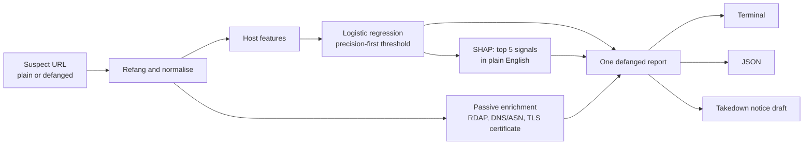

# phish-triage

[](https://github.com/anchit15/phish-triage/actions/workflows/ci.yml)

[](LICENSE)

A command-line tool that classifies a suspicious URL as phishing or benign, explains the verdict in plain English, finds the registrar's and hosting provider's abuse contacts, and drafts a takedown notice, without ever visiting the page.

> **v0.1, in active development.** The classifier, enrichment, CLI and evaluation work end to end. An API, a Docker image and a multi-day evaluation are planned for v1.0.

## Demo

```text
phish-triage 0.1.0 | 2026-11-22T20:32:48Z
  URL            hxxps://allegrolokalnie[.]ogoszenie-8690384[.]sbs/
  Verdict        PHISHING | probability >0.99 | threshold 0.80 (set for 98% precision on validation data)

Model signals: top 5 SHAP contributions
  + phishing    The host contains 7 digits; legitimate hosts in the training dataset have a median of 0.
  + phishing    The host has 1 subdomain level in front of the registered domain, a common way to bury the real domain.
  + phishing    The host is 37 characters long; legitimate hosts in the training dataset have a median of 15.
  + phishing    The host contains 1 hyphen, common in brand-imitation domains such as secure-brand-login.
  - legitimate  The registered name is 17 characters long; legitimate domains in the training dataset have a median of 10.

Enrichment: registry, DNS and TLS facts (not used by the model)
  Domain         ogoszenie-8690384[.]sbs | registered 2026-11-20 (2 days ago) | Hosting Concepts B.V. d/b/a Registrar.eu
  Hosting        172[.]67[.]211[.]81 | AS13335 | Cloudflare, Inc.
  ! CDN          Cloudflare is a CDN/reverse proxy: the origin server is hidden. Report to Cloudflare's abuse contact; they can identify the origin host.

URL structure flags (not used by the model)
  @ before host (hides real host)     no
  // inside path (embedded redirect)  no

Abuse contacts
  Hosting (CDN)  abuse@cloudflare.com
  Registrar      abuse@registrar.eu

Unavailable
  host (asn_name): not present in lookup response
  tls (issuer, not_before): skipped: no-touch mode
```

<details>
<summary>Example takedown notice (draft)</summary>

> **DRAFT for analyst review — not sent.** Check every fact below before sending.

**To:** abuse@cloudflare.com
**Cc:** abuse@registrar.eu
**Subject:** Phishing site report: allegrolokalnie[.]ogoszenie-8690384[.]sbs

Dear Abuse Team,

We are writing to report a website that we believe is being used for phishing and that appears to be served through your network. We would be grateful if you could investigate and remove the content.

## Reported URL

`hxxps://allegrolokalnie[.]ogoszenie-8690384[.]sbs/`

(Defanged for safety: replace `hxxp` with `http` and `[.]` with `.`)

## Assessment

- Verdict: **phishing** (automated classification; probability >0.99, decision threshold 0.80)
- Report time: 2026-11-22 20:32 UTC

## Evidence

Registration, hosting and certificate details (from RDAP, DNS and TLS):

- Domain ogoszenie-8690384[.]sbs registered 2026-11-20 (2 days before this report) with Hosting Concepts B.V. d/b/a Registrar.eu.
- Resolves to 172[.]67[.]211[.]81 (AS13335, Cloudflare, Inc.).

URL characteristics identified by the automated classifier:

- The host contains 7 digits; legitimate hosts in the training dataset have a median of 0.
- The host has 1 subdomain level in front of the registered domain, a common way to bury the real domain.
- The host is 37 characters long; legitimate hosts in the training dataset have a median of 15.
- The host contains 1 hyphen, common in brand-imitation domains such as secure-brand-login.

URL structure:

- No userinfo (@) or embedded-redirect (//) tricks found in the URL.

## Note on hosting

This site is served through Cloudflare, a content delivery network and reverse proxy, so the origin server's address is hidden. We are contacting you as the provider able to identify the origin host and act on this report or pass it on.

## Request

Please remove or disable access to the content at the URL above and let us know once action has been taken. If you need more information, please reply to this message.

Kind regards,

[Analyst name]
[Organisation]
[Contact details]

</details>

## Why

A phishing site does most of its damage in its first hours, so takedowns need to be fast. But a hosting provider or registrar won't remove a site just because a model says "phishing, 97%". They need evidence they can check. phish-triage gives every verdict the specific signals behind it, finds the right abuse contacts and drafts the notice. The analyst reviews the verdict and the notice, then decides whether to send it.

## Results

**Held-out test set**: 47,468 PhiUSIIL URLs (20,311 phishing, 27,157 legitimate), split by registered domain so no domain appears in both training and test.

| Threshold | Precision | Recall | F1 | ROC-AUC |
|---|---|---|---|---|
| 0.798 (chosen for precision ≥ 0.98 on validation data) | 0.976 | 0.665 | 0.791 | 0.896 |
| 0.5 | 0.937 | 0.708 | 0.807 | 0.896 |

**Fresh feed test (2026-11-22)**: 1,174 live phishing hosts from OpenPhish and phishunt.io (deduplicated by host, domains seen in training removed) against 1,174 random Tranco top-100k homepages (list 46YLX), at threshold 0.798.

| Recall | False-positive rate | Precision | F1 | ROC-AUC |
|---|---|---|---|---|
| 0.813 | 0.038 | 0.955 | 0.878 | 0.932 |

| Phishing hosts | Count | Recall |
|---|---|---|
| On shared platforms (blogspot, pages.dev, vercel.app, …) | 709 | 0.997 |
| On dedicated domains | 465 | 0.531 |

The dedicated-domain recall is the more honest figure: shared-platform recall is inflated by a dataset artifact (see Limitations), and Tranco homepages are easy negatives.

## How it works



Key design decisions:

- **Host-only model.** Every legitimate PhiUSIIL URL is a bare `https://www.` homepage, so the scheme, `www` and path leak the label: a model using only those three flags reaches ROC-AUC 0.995 on the test set.
- **Split grouped by registered domain.** The same domain never appears in both training and test, so the score measures generalisation rather than memorisation.
- **Precision-first threshold.** A false positive means a takedown request against a legitimate site, so the threshold is set on validation data for precision ≥ 0.98.
- **Passive enrichment only.** RDAP, DNS and certificate metadata; no HTTP request is ever sent to the suspect URL, and `--no-touch` also skips the TLS handshake.
- **Defanged everywhere.** Suspect URLs, hosts and IPs are defanged in the terminal, the JSON and the notice.
- **An analyst reviews every notice.** The tool drafts notices and never sends them; each draft is labelled as such.

## Quick start

```bash
git clone https://github.com/anchit15/phish-triage.git
cd phish-triage

python3.11 -m venv .venv          # Windows: py -3.11 -m venv .venv
source .venv/bin/activate         # Windows (Git Bash): source .venv/Scripts/activate
pip install -r requirements.txt
pip install -e . --no-deps

python scripts/download_data.py   # PhiUSIIL CSV into data/
python -m phish_triage.train      # writes models/model.joblib
python -m phish_triage.evaluate   # writes reports/metrics.json and summary.md

phish-triage "hxxps://secure-login[.]account-verify[.]example[.]com/signin" --no-touch
phish-triage "hxxps://secure-login[.]account-verify[.]example[.]com/signin" --json
phish-triage "hxxps://secure-login[.]account-verify[.]example[.]com/signin" --notice notice.md
```

The CLI accepts plain or defanged URLs. Enrichment queries registries and DNS only; settings (timeout, cache directory, no-touch) are documented in `.env.example`.

Optional fresh-feed evaluation:

```bash
python scripts/snapshot_feeds.py                 # today's OpenPhish and phishunt.io feeds
python scripts/download_tranco.py                # latest list; --list-id 46YLX reproduces ours
python -m phish_triage.fresh --date YYYY-MM-DD   # writes reports/fresh_YYYY-MM-DD.json
```

## Project structure

```text
phish-triage/
├── src/phish_triage/
│   ├── cli.py         # command-line entry point
│   ├── features.py    # host-only URL features
│   ├── train.py       # grouped split, model selection, threshold
│   ├── evaluate.py    # held-out metrics, bias check, error analysis
│   ├── fresh.py       # live feed vs Tranco evaluation
│   ├── explain.py     # SHAP signals in plain English
│   ├── enrich.py      # RDAP, DNS/ASN and TLS certificate lookups
│   ├── report.py      # one defanged report for all outputs
│   ├── notice.py      # takedown notice renderer
│   └── defang.py      # defang and refang URLs
├── templates/notice.md
├── scripts/           # dataset, feed and Tranco downloads
├── tests/             # offline tests; network access is blocked
└── docs/              # sample output and notice
```

## Limitations and future work

- Host-only model: every legitimate PhiUSIIL URL is a bare `https://www.` homepage, so the scheme, www and path can't be learned honestly.
- Misses phishing on hacked legitimate sites and plain-looking domains: 77% of held-out misses look ordinary, and only 53% of dedicated phishing domains in the live feed were caught.
- Domain age, registrar and certificate are shown to the analyst but not used by the model, so a brand-new domain can still score low.
- Shared-platform recall (99.7%) is flattered: almost no legitimate PhiUSIIL URL has a subdomain (2.9% vs 54.3% of phishing).
- Precision is measured at a 1:1 balance, and Tranco homepages are easy negatives, so real-world precision would be lower.
- Fresh-feed results come from one day's snapshot; feeds may contain non-phishing entries, and the shared-platform list was extended after reviewing that feed.
- Correlated length features can give counter-intuitive signal directions; the notice lists only signals pointing towards phishing.
- Behind a CDN such as Cloudflare, the origin server is hidden; the notice routes to the CDN's abuse contact and says so.
- Future work (v1.0): brand-in-host feature and a domain-age flag, measured on a week of new feeds; an API and a Docker image; legitimate URLs with paths for harder negatives.

## Data and attribution

- **PhiUSIIL Phishing URL Dataset**: A. Prasad and S. Chandra, "PhiUSIIL: A diverse security profile empowered phishing URL detection framework based on similarity index and incremental learning", *Computers & Security* 136 (2024) 103545, [doi:10.1016/j.cose.2023.103545](https://doi.org/10.1016/j.cose.2023.103545). UCI Machine Learning Repository, id 967, CC BY 4.0. Only the URL and label columns are used; the data is downloaded by a script, not redistributed.
- **OpenPhish**: phishing intelligence provided by [OpenPhish](https://openphish.com). Feed data is not redistributed.
- **phishunt.io**: feed published under CC0.
- **Tranco**: V. Le Pochat, T. Van Goethem, S. Tajalizadehkhoob, M. Korczyński and W. Joosen, "Tranco: A Research-Oriented Top Sites Ranking Hardened Against Manipulation", NDSS 2019, [doi:10.14722/ndss.2019.23386](https://doi.org/10.14722/ndss.2019.23386). List used: [46YLX](https://tranco-list.eu/list/46YLX).

## Licence

MIT. See [LICENSE](LICENSE).
